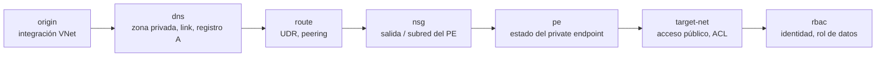

# reachwhy

**Tu Function App no llega a su private endpoint. reachwhy te dice qué salto falla y por qué.**

Diagnóstico de solo lectura, salto por salto, para Azure: DNS, red y RBAC.

[Read in English](README.md)

[](https://github.com/p3rformative/reachwhy/actions/workflows/ci.yml)


[](LICENSE)

> **Estado: pre-alfa.** Todavía no hay aplicación: ni interfaz de escritorio ni recolector para Azure. Hoy el repo contiene el diseño, los JSON Schema, casos de prueba sintéticos, las herramientas de higiene de datos y un prototipo en Python que analiza un archivo de snapshot local para el salto dns y el enrutamiento de la aplicación (fase 1, en un pull request). Todo lo que abajo describe la app es comportamiento previsto y está marcado así.

## Demo

Aún no hay GIF ni captura, porque la app no existe. Esta es la **salida prevista** para el caso sintético [`corpus/demo-basic-01`](corpus/demo-basic-01). Los estados y códigos salen del [`expected.json`](corpus/demo-basic-01/expected.json) de ese caso; los saltos que el caso no afirma se muestran con `·`.

*Siempre es el DNS. Excepto cuando también es RBAC.*

```text
# ejemplo sintético, salida prevista (el prototipo en Python solo evalúa por ahora los saltos origin (enrutamiento) y dns)
origen   func-demo  (Function App, integración VNet: snet-func-demo)
destino  stdemo001  (Storage, blob, private endpoint pe-st-demo-blob)

global: ROJO    primer salto en rojo: dns

  ·  origin      integración VNet      no lo afirma este caso
  ✘  dns         DNS_ZONE_NOT_LINKED   privatelink.blob.core.windows.net no tiene link a vnet-demo
  ·  route       UDR / peering         no lo afirma este caso
  ·  nsg         reglas NSG            no lo afirma este caso
  ✔  pe          private endpoint      pe-st-demo-blob está Approved
  ·  target-net  red del destino       no lo afirma este caso
  ✘  rbac        RBAC_NO_DATA_ROLE     la identidad administrada de func-demo no tiene rol de datos en stdemo001

  ✔ verde   ✘ rojo (causa exacta)   ? ámbar (no verificable desde el plano de control)   · no afirmado
```

Se reemplazará por una grabación real (por ejemplo con [vhs](https://github.com/charmbracelet/vhs) o [asciinema](https://asciinema.org/)) cuando haya código que ejecutar, solo con datos sintéticos de `corpus/`.

## Qué resuelve

Tu Function App, Container App o App Service da timeout contra un Storage, Key Vault o SQL detrás de un private endpoint.
El DNS se ve bien desde tu laptop, el portal muestra el endpoint como Approved y la app sigue dando timeout o 403.
¿Es la zona DNS privada, una UDR o un NSG, el endpoint o un rol de datos que falta? reachwhy busca responder eso por salto, con la causa exacta y la evidencia que leyó.

## ¿Por qué no basta con nslookup o Connection Troubleshoot?

- **Connection Troubleshoot, Connection Monitor y Network Verifier** no listaban Function Apps, Container Apps ni App Service como origen en su documentación (leída el 2026-11-12, ver [Related tools](docs/design.md#related-tools)). reachwhy parte del origen PaaS.
- **nslookup y las sondas en ejecución** como [azpe](https://github.com/nukabo/azpe) muestran a qué resuelve un nombre desde donde se ejecutan. reachwhy busca leer el plano de control y decir por qué, salto por salto: zona, link a la VNet, registro A, estado del endpoint, rol de datos. Son complementarios: los resultados en ejecución se pueden importar como `evidence.runtime`.
- **Las herramientas de topología** como [azlinks](https://github.com/bmw99x/azlinks) mapean recursos y algunos hallazgos. reachwhy apunta a un veredicto por salto: verde, rojo con código de causa o ámbar cuando no puede saberlo.

## Cómo funciona (previsto)

reachwhy lee el plano de control de Azure (Resource Graph y ARM, solo lectura, con tu propio `az login`), arma un snapshot JSON local y le aplica un motor de reglas puro. Cada salto queda en uno de tres estados: **verde**, **rojo** con un código de causa exacta, o **ámbar** cuando no se puede verificar con los datos disponibles. El motor evalúa todos los saltos; no se detiene en el primer rojo.



El orden de saltos, los códigos de regla y el modelo de datos están en [docs/design.md](docs/design.md) (en inglés). Los formatos del snapshot y del veredicto esperado ya existen como JSON Schema en [`schemas/`](schemas).

## Límites

- Solo plano de control: no lee app settings, la configuración DNS en tiempo de ejecución ni el tráfico real, así que muchos casos terminarán en **ámbar**. Ámbar significa "no puedo afirmarlo", no "está bien".
- Verde significa "sin falla detectada con la evidencia disponible", no "funciona".
- Solo Azure. Alcance previsto: 3 orígenes × 3 destinos. No sustituye una prueba hecha desde la propia carga.
- Nunca escribe en Azure. Los arreglos sugeridos son texto que tú ejecutas.

Detalle y lista completa de lo que queda fuera: [docs/design.md](docs/design.md#out-of-scope).

## Estado y roadmap

| Área | Hoy | Previsto |
|---|---|---|
| Orígenes | ninguno (sin código) | Function App, App Service, Container App |
| Destinos | ninguno (sin código) | Storage (blob, file, queue, table, dfs), Key Vault, Azure SQL Database, todos detrás de un private endpoint |
| Formatos | JSON Schema del snapshot y del veredicto esperado (v1.0.0) | importar evidencia en ejecución (`evidence.runtime`, ya es un campo opcional del esquema) |
| Corpus de pruebas | 11 casos sintéticos (`demo-basic-01` y 10 de la fase 1) | más casos sintéticos reconstruidos desde artículos públicos de troubleshooting |
| Prototipo de análisis | Python: salto dns y enrutamiento de la aplicación sobre un snapshot local (fase 1) | los demás saltos, luego el motor en Rust |
| Herramientas | gitleaks e higiene de datos en CI y pre-commit; tests del prototipo (pytest) en CI | tests del motor en Rust sobre el corpus en CI |

Ver [ROADMAP.md](ROADMAP.md).

### Permisos de Azure previstos

El diseño solo pide **Reader** en las suscripciones o grupos de recursos involucrados (incluido el que tiene las zonas DNS privadas). Sin Contributor, sin `list keys`, sin app settings, sin plano de datos. Lo que el usuario no pueda leer queda en ámbar, nunca en rojo. Nada de esto está implementado; ver [docs/design.md](docs/design.md#planned-permissions).

## Desarrollo

Requisitos: git y Python 3.12. Opcional: [gitleaks](https://github.com/gitleaks/gitleaks) 8.30.1 (versión fija, ver [docs/tooling.md](docs/tooling.md)).

bash:

```sh
git clone https://github.com/p3rformative/reachwhy.git && cd reachwhy
scripts/install-hooks.sh
python -m unittest discover -s scripts/ci/tests -v
python scripts/ci/check_hygiene.py corpus schemas docs
gitleaks git --no-banner --redact --config .gitleaks.toml .
```

PowerShell:

```powershell
git clone https://github.com/p3rformative/reachwhy.git; Set-Location reachwhy
./scripts/install-hooks.ps1
python -m unittest discover -s scripts/ci/tests -v
python scripts/ci/check_hygiene.py corpus schemas docs
gitleaks git --no-banner --redact --config .gitleaks.toml .
```

Prototipo de la fase 1 (Python 3.12+; solo lee archivos locales, sin red ni acceso a Azure). Se ejecuta desde la raíz del repositorio de dos maneras:

```sh
# Bash: opción 1, sin instalar (desde la raíz del repo)
PYTHONPATH=src python3 -m reachwhy --case corpus/synthetic-dns-fallback-01

# Bash: opción 2, instalación editable (agrega el comando `reachwhy`)
python3 -m pip install -e .
reachwhy --case corpus/synthetic-dns-fallback-01
reachwhy ruta/al/snapshot.json --origin <id-origen> --target <id-destino> --subresource blob

# tests
python3 -m pip install -e '.[test]'   # pytest y jsonschema
python3 -m pytest
```

```powershell
# PowerShell: opción 1, sin instalar (desde la raíz del repo)
$env:PYTHONPATH = 'src'; python -m reachwhy --case corpus/synthetic-dns-fallback-01

# PowerShell: opción 2, instalación editable (agrega el comando `reachwhy`)
python -m pip install -e .
reachwhy --case corpus/synthetic-dns-fallback-01

# tests
python -m pip install -e '.[test]'   # pytest y jsonschema
python -m pytest
```

Desde Python (después de `pip install -e .`, o con `src` en `PYTHONPATH`):

```python
import json
from reachwhy import analyze

case = "corpus/synthetic-dns-fallback-01"
snapshot = json.load(open(f"{case}/snapshot.json", encoding="utf-8"))
pair = json.load(open(f"{case}/expected.json", encoding="utf-8"))["pair"]
verdict = analyze(snapshot, pair["origin"], pair["target"], pair["targetSubresource"])
print(verdict["overall"], verdict["summary"])
```

El comando imprime el veredicto como JSON y termina con código 1 si el veredicto global es rojo, y 0 en otro caso. El veredicto siempre es parcial (`complete: false`): solo se evalúan los saltos `origin` (enrutamiento de la aplicación) y `dns`, así que `overall` nunca es `green`: si no se encuentra una falla es `amber`, y `summary` dice "2 of 7 hops evaluated". Todo veredicto de `dns` lleva la salvedad de que las app settings `WEBSITE_DNS_SERVER` y `WEBSITE_DNS_ALT_SERVER` no son legibles con Reader. El CI ejecuta estos tests en el job `tests` (ver [docs/pending-ci.md](docs/pending-ci.md)).

Todo dato del repo es sintético: IPs solo en `10.20.0.0/16` y rangos de documentación, nombres con `demo` o `example`, GUID de ceros. Los snapshots crudos o reales (`*.raw.json`, `*.real.json`, `snapshots/`) están en `.gitignore` y el hook los rechaza.

## Contribuir y seguridad

- [CONTRIBUTING.md](CONTRIBUTING.md): cómo proponer cambios y agregar casos al corpus.
- [SECURITY.md](SECURITY.md): reporta vulnerabilidades en privado con GitHub Security Advisories.
- [CODE_OF_CONDUCT.md](CODE_OF_CONDUCT.md): Contributor Covenant 2.1.

## Estructura del repo

| Ruta | Contenido |
|---|---|
| `docs/design.md` | Arquitectura prevista, reglas por salto, modelo de datos y formato del corpus. |
| `ROADMAP.md` | Lo previsto, en orden. Nada de eso existe todavía. |
| `docs/tooling.md` | Versión fija de gitleaks, hooks y comprobaciones locales. |
| `docs/pending-ci.md` | CI activo y CI previsto pero no activado. |
| `schemas/` | JSON Schema del snapshot y de `expected.json`. |
| `corpus/` | Casos sintéticos de "repro de red". Hoy: `demo-basic-01`. |
| `scripts/ci/` | Comprobación de higiene de datos sintéticos y sus tests. |
| `.githooks/` | Hook pre-commit (higiene y gitleaks si está instalado). |
| `.github/workflows/ci.yml` | CI: `gitleaks` e `hygiene`. |

Sin íconos de Azure ni de Microsoft en este repo.

## Licencia

[MIT](LICENSE) © 2026 Jorge González (p3rformative).
