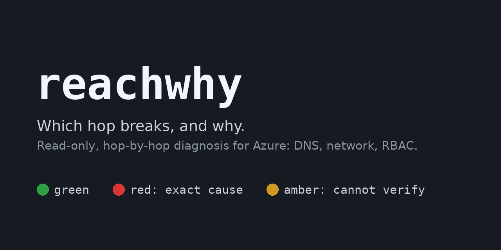
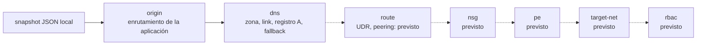

# reachwhy

**Qué salto falla, y por qué.**

Tu Function App no llega a su private endpoint. reachwhy es un diagnóstico de solo lectura, salto por salto, para Azure: DNS, red y RBAC. Hoy es un prototipo pre-alfa en Python que analiza un snapshot JSON local para dos saltos; el recolector de Azure y la interfaz de escritorio siguen previstos.

[Read in English](README.md)

[](https://github.com/p3rformative/reachwhy/actions/workflows/ci.yml)

[](LICENSE)




> **Estado: pre-alfa.** Todavía no hay interfaz de escritorio ni recolector para Azure. En `main` el repo tiene el diseño, los JSON Schema, 11 casos de prueba sintéticos, las herramientas de higiene de datos y un prototipo en Python que analiza un snapshot local para el salto `dns` y el enrutamiento de la aplicación (fase 1, ya en `main`, integrada en [#1](https://github.com/p3rformative/reachwhy/pull/1)). Todo lo que describe la app futura está marcado como previsto.

## Por qué

Tu Function App, Container App o App Service da timeout contra un Storage, Key Vault o SQL detrás de un private endpoint.
El DNS se ve bien desde tu laptop, el portal muestra el endpoint como Approved y la app sigue dando timeout o 403.
¿Es la zona DNS privada, una UDR o un NSG, el endpoint o un rol de datos que falta? reachwhy busca responder eso por salto, con la causa exacta y la evidencia que leyó.

¿Por qué no basta con nslookup o Connection Troubleshoot?

- **Connection Troubleshoot, Connection Monitor y Network Verifier** no listaban Function Apps, Container Apps ni App Service como origen en su documentación (leída el 2026-11-12, ver [Related tools](docs/design.md#related-tools)). reachwhy parte del origen PaaS.
- **nslookup y las sondas en ejecución** como [azpe](https://github.com/nukabo/azpe) muestran a qué resuelve un nombre desde donde se ejecutan. reachwhy busca leer el plano de control y decir por qué, salto por salto: zona, link a la VNet, registro A, estado del endpoint, rol de datos. Son complementarios: los resultados en ejecución se pueden importar como `evidence.runtime` (previsto; el campo ya existe en el esquema).
- **Las herramientas de topología** como [azlinks](https://github.com/bmw99x/azlinks) mapean recursos y algunos hallazgos. reachwhy apunta a un veredicto por salto: verde, rojo con código de causa o ámbar cuando no puede saberlo.

## Características

**Hoy**, en `main` (prototipo de la fase 1, Python 3.12+):

- Analiza un snapshot JSON local. Sin red, sin llamadas a Azure, sin credenciales.
- Evalúa 2 de 7 saltos: `origin` (enrutamiento de la aplicación del sitio) y `dns` (zona privada, link a la VNet, registro A, fallback a internet, DNS personalizado del sitio o de la VNet, y zonas presentes en otras suscripciones del snapshot).
- Cada salto evaluado queda **verde**, **rojo** con un código de causa, o **ámbar** cuando no se puede verificar. Los códigos citan una página de Microsoft Learn en `sources`.
- El veredicto siempre es parcial (`complete: false`). `overall` nunca es `green` mientras falten saltos: si en los evaluados no hay falla, `overall` es `amber`.
- Todo veredicto de `dns` lleva la salvedad de que las app settings `WEBSITE_DNS_SERVER` y `WEBSITE_DNS_ALT_SERVER` no son legibles con Reader.
- Incluye 11 casos sintéticos en el corpus y los JSON Schema del snapshot y del veredicto esperado (v1.0.0).
- El workflow de CI `ci` (`.github/workflows/ci.yml`) corre `gitleaks`, `hygiene` y `tests` (pytest).

**Previsto** (aún no está construido; ver [ROADMAP.md](ROADMAP.md)):

- Recolector de solo lectura con tu propio `az login` (Resource Graph y GET de ARM), que escribe snapshots fuera de git.
- Interfaz de escritorio (Tauri) con un modo demo sobre datos sintéticos.
- Los saltos que faltan: `route`, `nsg`, `pe`, `target-net`, `rbac`.
- Un motor de reglas en Rust y, más adelante, importar evidencia en ejecución (`evidence.runtime`).
- Alcance de la primera versión: Function App, App Service y Container App como orígenes; Storage, Key Vault y Azure SQL Database detrás de un private endpoint como destinos. El prototipo de hoy lee propiedades del sitio desde un snapshot (los casos del corpus usan una Function App y un Storage blob). La integración VNet, la delegación de subred y las reglas de origen para Container Apps todavía no están implementadas.

## Inicio rápido

Requisitos: git y Python 3.12+. El prototipo solo lee archivos locales.

```sh
git clone https://github.com/p3rformative/reachwhy.git && cd reachwhy
PYTHONPATH=src python3 -m reachwhy --case corpus/synthetic-dns-fallback-01
```

PowerShell:

```powershell
git clone https://github.com/p3rformative/reachwhy.git; Set-Location reachwhy
$env:PYTHONPATH = 'src'; python -m reachwhy --case corpus/synthetic-dns-fallback-01
```

O instala el comando `reachwhy` y corre los tests:

```sh
python3 -m pip install -e '.[test]'
reachwhy --case corpus/synthetic-dns-fallback-01
reachwhy ruta/al/snapshot.json --origin <id-origen> --target <id-destino> --subresource blob
python3 -m pytest
```

El comando imprime el veredicto como JSON y termina con código 1 si `overall` es `red`, o 0 en cualquier otro caso (incluido `amber`).

Desde Python (después de `pip install -e .`, o con `src` en `PYTHONPATH`):

```python
import json
from reachwhy import analyze

case = "corpus/synthetic-dns-fallback-01"
snapshot = json.load(open(f"{case}/snapshot.json", encoding="utf-8"))
pair = json.load(open(f"{case}/expected.json", encoding="utf-8"))["pair"]
verdict = analyze(snapshot, pair["origin"], pair["target"], pair["targetSubresource"])
print(verdict["overall"], verdict["summary"])
```

## Demo

Esta es la **salida real del CLI** del comando de arriba, para el caso sintético [`corpus/synthetic-dns-fallback-01`](corpus/synthetic-dns-fallback-01). En resumen: `overall` es `amber`, `complete` es `false`, `origin` queda en verde (el tráfico de la aplicación sale por la VNet) y `dns` queda en ámbar con `DNS_FALLBACK_TO_PUBLIC`. Código de salida: 0.

<details>
<summary>Veredicto JSON completo (clic para expandir)</summary>

```json
{
  "pair": {
    "origin": "/subscriptions/00000000-0000-0000-0000-000000000000/resourcegroups/rg-demo/providers/microsoft.web/sites/func-demo",
    "target": "/subscriptions/00000000-0000-0000-0000-000000000000/resourcegroups/rg-demo/providers/microsoft.storage/storageaccounts/stdemo001",
    "targetSubresource": "blob"
  },
  "overall": "amber",
  "firstRedHop": null,
  "complete": false,
  "summary": "2 of 7 hops evaluated (origin, dns); not evaluated: route, nsg, pe, target-net, rbac.",
  "evaluatedHops": [
    "origin",
    "dns"
  ],
  "notEvaluated": [
    "route",
    "nsg",
    "pe",
    "target-net",
    "rbac"
  ],
  "hops": [
    {
      "id": "origin",
      "state": "green",
      "code": null,
      "cause": "Application traffic is routed through the VNet integration.",
      "evidence": [
        {
          "kind": "arm",
          "resource": "/subscriptions/00000000-0000-0000-0000-000000000000/resourcegroups/rg-demo/providers/microsoft.web/sites/func-demo",
          "path": "properties.vnetRouteAllEnabled",
          "value": true
        }
      ],
      "sources": [
        "https://learn.microsoft.com/en-us/azure/app-service/configure-vnet-integration-routing",
        "https://learn.microsoft.com/en-us/azure/app-service/overview-vnet-integration"
      ],
      "caveats": [
        "Only application routing was evaluated; VNet integration and subnet delegation are not evaluated yet."
      ]
    },
    {
      "id": "dns",
      "state": "amber",
      "code": "DNS_FALLBACK_TO_PUBLIC",
      "cause": "Zone privatelink.blob.core.windows.net is linked but has no A record for stdemo001; the link has fallback to internet (NxDomainRedirect), so the name is retried through public recursion and resolves to a public IP. Whether that is reachable depends on the target's public network access.",
      "evidence": [
        {
          "kind": "arm",
          "resource": "/subscriptions/00000000-0000-0000-0000-000000000000/resourcegroups/rg-demo/providers/microsoft.network/privatednszones/privatelink.blob.core.windows.net",
          "path": "A records",
          "value": []
        },
        {
          "kind": "arm",
          "resource": "/subscriptions/00000000-0000-0000-0000-000000000000/resourcegroups/rg-demo/providers/microsoft.network/privatednszones/privatelink.blob.core.windows.net",
          "path": "virtualNetworkLinks.resolutionPolicy",
          "value": "NxDomainRedirect"
        },
        {
          "kind": "arm",
          "resource": "/subscriptions/00000000-0000-0000-0000-000000000000/resourcegroups/rg-demo/providers/microsoft.storage/storageaccounts/stdemo001",
          "path": "properties.publicNetworkAccess",
          "value": "Disabled"
        }
      ],
      "sources": [
        "https://learn.microsoft.com/en-us/azure/dns/private-dns-fallback"
      ],
      "caveats": [
        "App settings WEBSITE_DNS_SERVER and WEBSITE_DNS_ALT_SERVER are not readable with Reader: this verdict assumes they are not set; only the site property dnsConfiguration was checked."
      ],
      "whyUnverifiable": "The result depends on the target's public network access (target-net hop, not evaluated here).",
      "howToVerify": "From a VM inside the integration VNet: Resolve-DnsName stdemo001.blob.core.windows.net -Type A | Select-Object Name, IPAddress  (expect a private IP of the endpoint)"
    }
  ]
}
```

</details>

Todavía no hay GIF ni grabación de terminal. Este es un espacio reservado para una grabación real (por ejemplo con [vhs](https://github.com/charmbracelet/vhs) o [asciinema](https://asciinema.org/)), hecha solo con datos sintéticos de `corpus/`, nunca de un entorno real. No agregues una falsa.

La tabla de abajo es **presentación prevista**, no lo que imprime el CLI hoy. Los estados y códigos salen del [`expected.json`](corpus/demo-basic-01/expected.json) de [`corpus/demo-basic-01`](corpus/demo-basic-01); los saltos que el caso no afirma se muestran con `·`. El prototipo solo evalúa `origin` y `dns`, así que todavía no emite las filas de `pe` ni de `rbac`.

*Siempre es el DNS. Excepto cuando también es RBAC.*

```text
# ejemplo sintético, salida prevista
origen   func-demo  (Function App, integración VNet: snet-func-demo)
destino  stdemo001  (Storage, blob, private endpoint pe-st-demo-blob)

global: ROJO    primer salto en rojo: dns

  ·  origin      integración VNet      no lo afirma este caso
  ✘  dns         DNS_ZONE_NOT_LINKED   privatelink.blob.core.windows.net no tiene link a vnet-demo
  ·  route       UDR / peering         no lo afirma este caso
  ·  nsg         reglas NSG            no lo afirma este caso
  ✔  pe          private endpoint      pe-st-demo-blob está Approved
  ·  target-net  red del destino       no lo afirma este caso
  ✘  rbac        RBAC_NO_DATA_ROLE     la identidad administrada de func-demo no tiene rol de datos en stdemo001

  ✔ verde   ✘ rojo (causa exacta)   ? ámbar (no verificable desde el plano de control)   · no afirmado
```

## Cómo funciona

**Hoy:** apuntas el prototipo en Python a un snapshot local (o a un caso del corpus). Un motor de reglas puro evalúa `origin` y `dns` e imprime un veredicto JSON. Nunca llama a Azure.

**Previsto:** un recolector de solo lectura usa tu `az login` (Resource Graph y ARM) para armar ese snapshot, el motor evalúa los siete saltos y una interfaz de escritorio muestra la ruta. El motor tampoco se detendrá en el primer salto en rojo.



El orden de saltos, los códigos de regla y el modelo de datos están en [docs/design.md](docs/design.md) (en inglés). Los formatos del snapshot y del veredicto esperado ya existen como JSON Schema en [`schemas/`](schemas).

## Límites

- Solo plano de control: no lee app settings, la configuración DNS en tiempo de ejecución ni el tráfico real, así que muchos casos terminarán en **ámbar**. Ámbar significa "no puedo afirmarlo", no "está bien".
- Verde significa "sin falla detectada con la evidencia disponible", no "funciona".
- Solo Azure. Alcance previsto: 3 orígenes × 3 destinos. No sustituye una prueba hecha desde la propia carga.
- Nunca escribe en Azure. Los arreglos sugeridos son texto que tú ejecutas.

Detalle y lista completa de lo que queda fuera: [docs/design.md](docs/design.md#out-of-scope).

## Estado y roadmap

| Área | Hoy | Previsto |
|---|---|---|
| Orígenes | Function App en un snapshot local (solo enrutamiento de la aplicación; sin recolector de Azure) | Function App, App Service, Container App |
| Destinos | Storage (blob) en un snapshot local, para los saltos ya implementados | Storage (blob, file, queue, table, dfs), Key Vault, Azure SQL Database, todos detrás de un private endpoint |
| Formatos | JSON Schema del snapshot y del veredicto esperado (v1.0.0) | importar evidencia en ejecución (`evidence.runtime`, ya es un campo opcional del esquema) |
| Corpus de pruebas | 11 casos sintéticos (`demo-basic-01` y 10 de la fase 1) | más casos sintéticos reconstruidos desde artículos públicos de troubleshooting |
| Prototipo de análisis | Python: salto `dns` y enrutamiento de la aplicación sobre un snapshot local (fase 1, en `main`) | los demás saltos, luego el motor en Rust |
| Herramientas | gitleaks, higiene de datos y tests del prototipo (pytest) en CI y pre-commit | tests del motor en Rust sobre el corpus en CI |

Ver [ROADMAP.md](ROADMAP.md).

### Permisos de Azure previstos

El diseño solo pide **Reader** en las suscripciones o grupos de recursos involucrados (incluido el que tiene las zonas DNS privadas). Sin Contributor, sin `list keys`, sin app settings, sin plano de datos. Lo que el usuario no pueda leer queda en ámbar, nunca en rojo. El recolector que usaría estos permisos todavía no está implementado; ver [docs/design.md](docs/design.md#planned-permissions).

## Desarrollo

Opcional: [gitleaks](https://github.com/gitleaks/gitleaks) 8.30.1 (versión fija, ver [docs/tooling.md](docs/tooling.md)).

```sh
scripts/install-hooks.sh
python -m unittest discover -s scripts/ci/tests -v
python scripts/ci/check_hygiene.py corpus schemas docs
gitleaks git --no-banner --redact --config .gitleaks.toml .
```

PowerShell:

```powershell
./scripts/install-hooks.ps1
python -m unittest discover -s scripts/ci/tests -v
python scripts/ci/check_hygiene.py corpus schemas docs
gitleaks git --no-banner --redact --config .gitleaks.toml .
```

Todo dato del repo es sintético: IPs solo en `10.20.0.0/16` y rangos de documentación, nombres con `demo` o `example`, GUID de ceros. Los snapshots crudos o reales (`*.raw.json`, `*.real.json`, `snapshots/`) están en `.gitignore` y el hook los rechaza.

## Contribuir y seguridad

- [CONTRIBUTING.md](CONTRIBUTING.md): cómo proponer cambios y agregar casos al corpus.
- [SECURITY.md](SECURITY.md): reporta vulnerabilidades en privado con GitHub Security Advisories.
- [CODE_OF_CONDUCT.md](CODE_OF_CONDUCT.md): Contributor Covenant 2.1.

## Estructura del repo

| Ruta | Contenido |
|---|---|
| `src/reachwhy/` | Prototipo en Python de la fase 1: análisis de un snapshot local para `origin` y `dns`. |
| `docs/design.md` | Arquitectura prevista, reglas por salto, modelo de datos y formato del corpus. |
| `ROADMAP.md` | Lo que ya está hecho y lo previsto, en orden. |
| `docs/tooling.md` | Versión fija de gitleaks, hooks y comprobaciones locales. |
| `docs/pending-ci.md` | CI activo y CI previsto pero no activado. |
| `docs/social-preview.png` | Imagen social y de portada del README (1280×640). |
| `schemas/` | JSON Schema del snapshot y de `expected.json`. |
| `corpus/` | 11 casos sintéticos (`demo-basic-01` y 10 de la fase 1). |
| `scripts/ci/` | Comprobación de higiene de datos sintéticos y sus tests. |
| `.githooks/` | Hook pre-commit (higiene y gitleaks si está instalado). |
| `.github/workflows/ci.yml` | Jobs de CI: `gitleaks`, `hygiene` y `tests`. |

Sin íconos de Azure ni de Microsoft en este repo.

## Licencia

[MIT](LICENSE) © 2026 Jorge González (p3rformative).
