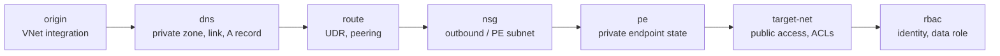

# reachwhy

**Your Function App can't reach its private endpoint. reachwhy tells you which hop breaks and why.**

Read-only, hop-by-hop diagnosis for Azure: DNS, network and RBAC.

[Leer en español](README.es.md)

[](https://github.com/p3rformative/reachwhy/actions/workflows/ci.yml)


[](LICENSE)

> **Status: pre-alpha.** There is no application yet: no desktop UI and no collector for Azure. Today the repo contains the design, the JSON schemas, synthetic test cases, the data-hygiene tooling and a Python prototype that analyzes a local snapshot file for the dns hop and application routing (phase 1, in a pull request). Everything below that describes the app is the planned behavior, and it is labeled as such.

## Demo

There is no GIF or screenshot yet, because the app does not exist. This is the **planned output** for the synthetic case [`corpus/demo-basic-01`](corpus/demo-basic-01). The hop states and codes come from that case's [`expected.json`](corpus/demo-basic-01/expected.json); hops the case does not assert are shown as `·`.

*It's always DNS. Except when it's also RBAC.*

```text
# synthetic example, planned output (the Python prototype evaluates only the origin routing and dns hops so far)
origin  func-demo  (Function App, VNet integration: snet-func-demo)
target  stdemo001  (Storage, blob, private endpoint pe-st-demo-blob)

overall: RED    first red hop: dns

  ·  origin      VNet integration      not asserted by this case
  ✘  dns         DNS_ZONE_NOT_LINKED   privatelink.blob.core.windows.net has no link to vnet-demo
  ·  route       UDR / peering         not asserted by this case
  ·  nsg         NSG rules             not asserted by this case
  ✔  pe          private endpoint      pe-st-demo-blob is Approved
  ·  target-net  target network        not asserted by this case
  ✘  rbac        RBAC_NO_DATA_ROLE     func-demo's managed identity has no data role on stdemo001

  ✔ green   ✘ red (exact cause)   ? amber (cannot be verified from the control plane)   · not asserted
```

To be replaced with a real recording (for example with [vhs](https://github.com/charmbracelet/vhs) or [asciinema](https://asciinema.org/)) once there is code to run, using only synthetic data from `corpus/`.

## What it solves

Your Function App, Container App or App Service times out against a Storage account, Key Vault or SQL database behind a private endpoint.
DNS looks right from your laptop, the portal shows the endpoint as Approved, and the app still says timeout or 403.
Is it the private DNS zone, a UDR or NSG, the endpoint itself, or a missing data role? reachwhy is meant to answer that per hop, with the exact cause and the evidence it read.

## Why not just nslookup or Connection Troubleshoot?

- **Connection Troubleshoot, Connection Monitor and Network Verifier** did not list Function Apps, Container Apps or App Service as sources in their documentation (read on 2026-11-12, see [Related tools](docs/design.md#related-tools)). reachwhy starts from the PaaS origin.
- **nslookup and runtime probes** such as [azpe](https://github.com/nukabo/azpe) show what a name resolves to from where they run. reachwhy is meant to read the control plane and say why, hop by hop: zone, VNet link, A record, endpoint state, data role. The two are complementary: runtime results can be imported as `evidence.runtime`.
- **Topology tools** such as [azlinks](https://github.com/bmw99x/azlinks) map resources and some findings. reachwhy aims at a verdict per hop: green, red with a cause code, or amber when it cannot tell.

## How it works (planned)

reachwhy reads the Azure control plane (Resource Graph and ARM, read-only, using your own `az login`), builds a local JSON snapshot, and runs a pure rule engine over it. Every hop gets one of three states: **green**, **red** with an exact cause code, or **amber** when it cannot be verified with the data available. The engine evaluates all hops; it does not stop at the first red one.



The hop order, rule codes and data model are described in [docs/design.md](docs/design.md). The snapshot and expected-verdict formats already exist as JSON Schemas in [`schemas/`](schemas).

## Limits

- Control plane only: it does not read app settings, runtime DNS configuration or real traffic, so many cases will end up **amber**. Amber means "cannot tell", not "fine".
- Green means "no failure found with the evidence available", not "it works".
- Azure only. Planned scope: 3 origins × 3 targets. It does not replace a test run from inside the workload.
- It never writes to Azure. Suggested fixes are text that you run yourself.

Details and the full out-of-scope list: [docs/design.md](docs/design.md#out-of-scope).

## Status and roadmap

| Area | Today | Planned |
|---|---|---|
| Origins | none (no code) | Function App, App Service, Container App |
| Targets | none (no code) | Storage (blob, file, queue, table, dfs), Key Vault, Azure SQL Database, all behind a private endpoint |
| Data formats | snapshot and expected-verdict JSON Schemas (v1.0.0) | runtime evidence import (`evidence.runtime`, already an optional schema field) |
| Test corpus | 11 synthetic cases (`demo-basic-01` and 10 for phase 1) | more synthetic cases reconstructed from public troubleshooting articles |
| Analysis prototype | Python: dns hop and application routing over a local snapshot (phase 1) | the other hops, then the Rust engine |
| Tooling | gitleaks and data-hygiene checks in CI and pre-commit; prototype tests (pytest) in CI | Rust engine tests over the corpus in CI |

See [ROADMAP.md](ROADMAP.md).

### Planned Azure permissions

The design requires only **Reader** on the subscriptions or resource groups involved (including the one that holds the private DNS zones). No Contributor, no `list keys`, no app settings, no data plane. Anything the user cannot read becomes amber, never red. Nothing is implemented yet; see [docs/design.md](docs/design.md#planned-permissions).

## Development

Requirements: git and Python 3.12. Optional: [gitleaks](https://github.com/gitleaks/gitleaks) 8.30.1 (pinned version, see [docs/tooling.md](docs/tooling.md)).

bash:

```sh
git clone https://github.com/p3rformative/reachwhy.git && cd reachwhy
scripts/install-hooks.sh
python -m unittest discover -s scripts/ci/tests -v
python scripts/ci/check_hygiene.py corpus schemas docs
gitleaks git --no-banner --redact --config .gitleaks.toml .
```

PowerShell:

```powershell
git clone https://github.com/p3rformative/reachwhy.git; Set-Location reachwhy
./scripts/install-hooks.ps1
python -m unittest discover -s scripts/ci/tests -v
python scripts/ci/check_hygiene.py corpus schemas docs
gitleaks git --no-banner --redact --config .gitleaks.toml .
```

Phase 1 prototype (Python 3.12+; it only reads local files, with no network and no Azure access). Run it from the repository root in one of two ways:

```sh
# Bash: option 1, no install (from the repo root)
PYTHONPATH=src python3 -m reachwhy --case corpus/synthetic-dns-fallback-01

# Bash: option 2, editable install (adds the `reachwhy` command)
python3 -m pip install -e .
reachwhy --case corpus/synthetic-dns-fallback-01
reachwhy path/to/snapshot.json --origin <origin-id> --target <target-id> --subresource blob

# tests
python3 -m pip install -e '.[test]'   # pytest and jsonschema
python3 -m pytest
```

```powershell
# PowerShell: option 1, no install (from the repo root)
$env:PYTHONPATH = 'src'; python -m reachwhy --case corpus/synthetic-dns-fallback-01

# PowerShell: option 2, editable install (adds the `reachwhy` command)
python -m pip install -e .
reachwhy --case corpus/synthetic-dns-fallback-01

# tests
python -m pip install -e '.[test]'   # pytest and jsonschema
python -m pytest
```

From Python (after `pip install -e .`, or with `src` on `PYTHONPATH`):

```python
import json
from reachwhy import analyze

case = "corpus/synthetic-dns-fallback-01"
snapshot = json.load(open(f"{case}/snapshot.json", encoding="utf-8"))
pair = json.load(open(f"{case}/expected.json", encoding="utf-8"))["pair"]
verdict = analyze(snapshot, pair["origin"], pair["target"], pair["targetSubresource"])
print(verdict["overall"], verdict["summary"])
```

The command prints the verdict as JSON and exits with 1 if the overall verdict is red, 0 otherwise. The verdict is always partial (`complete: false`): only the `origin` (application routing) and `dns` hops are evaluated, so `overall` is never `green`: with no failure found it is `amber`, and `summary` says "2 of 7 hops evaluated". Every `dns` verdict carries the caveat that app settings `WEBSITE_DNS_SERVER` and `WEBSITE_DNS_ALT_SERVER` are not readable with Reader. CI runs these tests in the `tests` job (see [docs/pending-ci.md](docs/pending-ci.md)).

All data in this repo is synthetic: IPs only in `10.20.0.0/16` and documentation ranges, names containing `demo` or `example`, all-zero GUIDs. Raw or real snapshots (`*.raw.json`, `*.real.json`, `snapshots/`) are git-ignored and rejected by the hook.

## Contributing and security

- [CONTRIBUTING.md](CONTRIBUTING.md): how to propose changes and add corpus cases.
- [SECURITY.md](SECURITY.md): report vulnerabilities privately through GitHub Security Advisories.
- [CODE_OF_CONDUCT.md](CODE_OF_CONDUCT.md): Contributor Covenant 2.1.

## Repository layout

| Path | Contents |
|---|---|
| `docs/design.md` | Planned architecture, hop rules, data model and corpus format. |
| `ROADMAP.md` | What is planned, in order. Nothing in it exists yet. |
| `docs/tooling.md` | Pinned gitleaks version, hooks and local checks. |
| `docs/pending-ci.md` | Active CI and CI that is planned but not enabled. |
| `schemas/` | JSON Schemas for the snapshot and for `expected.json`. |
| `corpus/` | Synthetic "network repro" cases. Today: `demo-basic-01`. |
| `scripts/ci/` | Synthetic-data hygiene check and its tests. |
| `.githooks/` | Pre-commit hook (hygiene, plus gitleaks if installed). |
| `.github/workflows/ci.yml` | CI: `gitleaks` and `hygiene`. |

No Azure or Microsoft icons are used in this repo.

## License

[MIT](LICENSE) © 2026 Jorge González (p3rformative).
