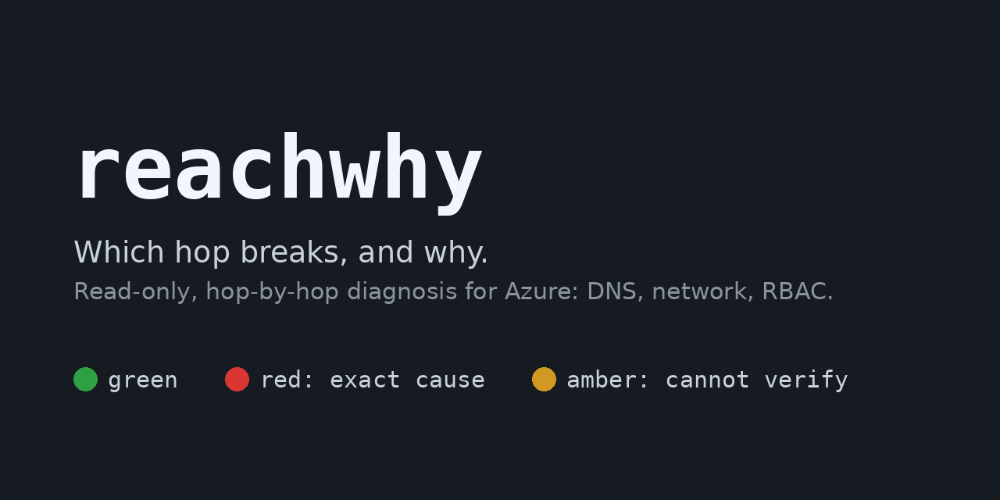
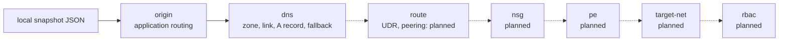

# reachwhy

**Which hop breaks, and why.**

Your Function App can't reach its private endpoint. reachwhy is a read-only, hop-by-hop diagnosis for Azure: DNS, network and RBAC. Today it is a pre-alpha Python prototype that analyzes a local JSON snapshot for two hops; the Azure collector and the desktop UI are still planned.

[Leer en español](README.es.md)

[](https://github.com/p3rformative/reachwhy/actions/workflows/ci.yml)

[](LICENSE)




> **Status: pre-alpha.** There is no desktop UI and no collector for Azure yet. On `main` the repo has the design, the JSON schemas, 11 synthetic test cases, the data-hygiene tooling, and a Python prototype that analyzes a local snapshot for the `dns` hop and application routing (phase 1, already on `main`, merged in [#1](https://github.com/p3rformative/reachwhy/pull/1)). Everything that describes the future app is labeled as planned.

## Why

Your Function App, Container App or App Service times out against a Storage account, Key Vault or SQL database behind a private endpoint.
DNS looks right from your laptop, the portal shows the endpoint as Approved, and the app still says timeout or 403.
Is it the private DNS zone, a UDR or NSG, the endpoint itself, or a missing data role? reachwhy is meant to answer that per hop, with the exact cause and the evidence it read.

Why not just nslookup or Connection Troubleshoot?

- **Connection Troubleshoot, Connection Monitor and Network Verifier** did not list Function Apps, Container Apps or App Service as sources in their documentation (read on 2026-11-12, see [Related tools](docs/design.md#related-tools)). reachwhy starts from the PaaS origin.
- **nslookup and runtime probes** such as [azpe](https://github.com/nukabo/azpe) show what a name resolves to from where they run. reachwhy is meant to read the control plane and say why, hop by hop: zone, VNet link, A record, endpoint state, data role. The two are complementary: runtime results can be imported as `evidence.runtime` (planned; the field already exists in the schema).
- **Topology tools** such as [azlinks](https://github.com/bmw99x/azlinks) map resources and some findings. reachwhy aims at a verdict per hop: green, red with a cause code, or amber when it cannot tell.

## Features

**Today**, on `main` (phase 1 prototype, Python 3.12+):

- Analyzes a local snapshot JSON. No network, no Azure calls, no credentials.
- Evaluates 2 of 7 hops: `origin` (application routing of the site) and `dns` (private zone, VNet link, A record, fallback to internet, site or VNet custom DNS, and zones present in other subscriptions in the snapshot).
- Each evaluated hop is **green**, **red** with a cause code, or **amber** when it cannot be verified. Cause codes cite a Microsoft Learn page in `sources`.
- The verdict is always partial (`complete: false`). `overall` is never `green` while other hops are unevaluated: if the evaluated hops have no failure, `overall` is `amber`.
- Every `dns` verdict carries the caveat that app settings `WEBSITE_DNS_SERVER` and `WEBSITE_DNS_ALT_SERVER` are not readable with Reader.
- Ships 11 synthetic corpus cases and JSON Schemas for the snapshot and the expected verdict (v1.0.0).
- CI workflow `ci` (`.github/workflows/ci.yml`) runs `gitleaks`, `hygiene` and `tests` (pytest).

**Planned** (not built yet; see [ROADMAP.md](ROADMAP.md)):

- Read-only collector using your own `az login` (Resource Graph and ARM GETs), writing snapshots outside git.
- Desktop UI (Tauri) with a demo mode on synthetic data.
- The remaining hops: `route`, `nsg`, `pe`, `target-net`, `rbac`.
- A Rust rule engine, and later runtime evidence import (`evidence.runtime`).
- First-version scope: Function App, App Service and Container App as origins; Storage, Key Vault and Azure SQL Database behind a private endpoint as targets. The prototype today reads site properties from a snapshot (corpus cases use a Function App and a Storage blob target). VNet integration, subnet delegation and Container Apps origin rules are not implemented yet.

## Quick start

Requirements: git and Python 3.12+. The prototype only reads local files.

```sh
git clone https://github.com/p3rformative/reachwhy.git && cd reachwhy
PYTHONPATH=src python3 -m reachwhy --case corpus/synthetic-dns-fallback-01
```

PowerShell:

```powershell
git clone https://github.com/p3rformative/reachwhy.git; Set-Location reachwhy
$env:PYTHONPATH = 'src'; python -m reachwhy --case corpus/synthetic-dns-fallback-01
```

Or install the `reachwhy` command and run the tests:

```sh
python3 -m pip install -e '.[test]'
reachwhy --case corpus/synthetic-dns-fallback-01
reachwhy path/to/snapshot.json --origin <origin-id> --target <target-id> --subresource blob
python3 -m pytest
```

The command prints the verdict as JSON and exits with 1 if `overall` is `red`, or 0 otherwise (including `amber`).

From Python (after `pip install -e .`, or with `src` on `PYTHONPATH`):

```python
import json
from reachwhy import analyze

case = "corpus/synthetic-dns-fallback-01"
snapshot = json.load(open(f"{case}/snapshot.json", encoding="utf-8"))
pair = json.load(open(f"{case}/expected.json", encoding="utf-8"))["pair"]
verdict = analyze(snapshot, pair["origin"], pair["target"], pair["targetSubresource"])
print(verdict["overall"], verdict["summary"])
```

## Demo

This is the **real CLI output** of the command above, for the synthetic case [`corpus/synthetic-dns-fallback-01`](corpus/synthetic-dns-fallback-01). At a glance: `overall` is `amber`, `complete` is `false`, `origin` is green (application traffic routed through the VNet), and `dns` is amber with `DNS_FALLBACK_TO_PUBLIC`. Exit code: 0.

<details>
<summary>Full JSON verdict (click to expand)</summary>

```json
{
  "pair": {
    "origin": "/subscriptions/00000000-0000-0000-0000-000000000000/resourcegroups/rg-demo/providers/microsoft.web/sites/func-demo",
    "target": "/subscriptions/00000000-0000-0000-0000-000000000000/resourcegroups/rg-demo/providers/microsoft.storage/storageaccounts/stdemo001",
    "targetSubresource": "blob"
  },
  "overall": "amber",
  "firstRedHop": null,
  "complete": false,
  "summary": "2 of 7 hops evaluated (origin, dns); not evaluated: route, nsg, pe, target-net, rbac.",
  "evaluatedHops": [
    "origin",
    "dns"
  ],
  "notEvaluated": [
    "route",
    "nsg",
    "pe",
    "target-net",
    "rbac"
  ],
  "hops": [
    {
      "id": "origin",
      "state": "green",
      "code": null,
      "cause": "Application traffic is routed through the VNet integration.",
      "evidence": [
        {
          "kind": "arm",
          "resource": "/subscriptions/00000000-0000-0000-0000-000000000000/resourcegroups/rg-demo/providers/microsoft.web/sites/func-demo",
          "path": "properties.vnetRouteAllEnabled",
          "value": true
        }
      ],
      "sources": [
        "https://learn.microsoft.com/en-us/azure/app-service/configure-vnet-integration-routing",
        "https://learn.microsoft.com/en-us/azure/app-service/overview-vnet-integration"
      ],
      "caveats": [
        "Only application routing was evaluated; VNet integration and subnet delegation are not evaluated yet."
      ]
    },
    {
      "id": "dns",
      "state": "amber",
      "code": "DNS_FALLBACK_TO_PUBLIC",
      "cause": "Zone privatelink.blob.core.windows.net is linked but has no A record for stdemo001; the link has fallback to internet (NxDomainRedirect), so the name is retried through public recursion and resolves to a public IP. Whether that is reachable depends on the target's public network access.",
      "evidence": [
        {
          "kind": "arm",
          "resource": "/subscriptions/00000000-0000-0000-0000-000000000000/resourcegroups/rg-demo/providers/microsoft.network/privatednszones/privatelink.blob.core.windows.net",
          "path": "A records",
          "value": []
        },
        {
          "kind": "arm",
          "resource": "/subscriptions/00000000-0000-0000-0000-000000000000/resourcegroups/rg-demo/providers/microsoft.network/privatednszones/privatelink.blob.core.windows.net",
          "path": "virtualNetworkLinks.resolutionPolicy",
          "value": "NxDomainRedirect"
        },
        {
          "kind": "arm",
          "resource": "/subscriptions/00000000-0000-0000-0000-000000000000/resourcegroups/rg-demo/providers/microsoft.storage/storageaccounts/stdemo001",
          "path": "properties.publicNetworkAccess",
          "value": "Disabled"
        }
      ],
      "sources": [
        "https://learn.microsoft.com/en-us/azure/dns/private-dns-fallback"
      ],
      "caveats": [
        "App settings WEBSITE_DNS_SERVER and WEBSITE_DNS_ALT_SERVER are not readable with Reader: this verdict assumes they are not set; only the site property dnsConfiguration was checked."
      ],
      "whyUnverifiable": "The result depends on the target's public network access (target-net hop, not evaluated here).",
      "howToVerify": "From a VM inside the integration VNet: Resolve-DnsName stdemo001.blob.core.windows.net -Type A | Select-Object Name, IPAddress  (expect a private IP of the endpoint)"
    }
  ]
}
```

</details>

There is no GIF or terminal recording yet. This is a placeholder for a real recording (for example with [vhs](https://github.com/charmbracelet/vhs) or [asciinema](https://asciinema.org/)), to be made from synthetic data in `corpus/` only, never from a real environment. Do not add a fake one.

The table below is **planned presentation**, not what the CLI prints today. Hop states and codes come from [`corpus/demo-basic-01/expected.json`](corpus/demo-basic-01/expected.json); hops the case does not assert are shown as `·`. The prototype currently evaluates only `origin` and `dns`, so it does not yet emit the `pe` or `rbac` rows.

*It's always DNS. Except when it's also RBAC.*

```text
# synthetic example, planned output
origin  func-demo  (Function App, VNet integration: snet-func-demo)
target  stdemo001  (Storage, blob, private endpoint pe-st-demo-blob)

overall: RED    first red hop: dns

  ·  origin      VNet integration      not asserted by this case
  ✘  dns         DNS_ZONE_NOT_LINKED   privatelink.blob.core.windows.net has no link to vnet-demo
  ·  route       UDR / peering         not asserted by this case
  ·  nsg         NSG rules             not asserted by this case
  ✔  pe          private endpoint      pe-st-demo-blob is Approved
  ·  target-net  target network        not asserted by this case
  ✘  rbac        RBAC_NO_DATA_ROLE     func-demo's managed identity has no data role on stdemo001

  ✔ green   ✘ red (exact cause)   ? amber (cannot be verified from the control plane)   · not asserted
```

## How it works

**Today:** you point the Python prototype at a local snapshot (or a corpus case). A pure rule engine evaluates `origin` and `dns` and prints a JSON verdict. It never calls Azure.

**Planned:** a read-only collector uses your `az login` (Resource Graph and ARM) to build that snapshot, then the engine evaluates all seven hops, and a desktop UI shows the path. The engine still will not stop at the first red hop.



The hop order, rule codes and data model are described in [docs/design.md](docs/design.md). The snapshot and expected-verdict formats already exist as JSON Schemas in [`schemas/`](schemas).

## Limits

- Control plane only: it does not read app settings, runtime DNS configuration or real traffic, so many cases will end up **amber**. Amber means "cannot tell", not "fine".
- Green means "no failure found with the evidence available", not "it works".
- Azure only. Planned scope: 3 origins × 3 targets. It does not replace a test run from inside the workload.
- It never writes to Azure. Suggested fixes are text that you run yourself.

Details and the full out-of-scope list: [docs/design.md](docs/design.md#out-of-scope).

## Status and roadmap

| Area | Today | Planned |
|---|---|---|
| Origins | Function App in a local snapshot (application routing only; no Azure collector) | Function App, App Service, Container App |
| Targets | Storage (blob) in a local snapshot, for the hops already implemented | Storage (blob, file, queue, table, dfs), Key Vault, Azure SQL Database, all behind a private endpoint |
| Data formats | snapshot and expected-verdict JSON Schemas (v1.0.0) | runtime evidence import (`evidence.runtime`, already an optional schema field) |
| Test corpus | 11 synthetic cases (`demo-basic-01` and 10 for phase 1) | more synthetic cases reconstructed from public troubleshooting articles |
| Analysis prototype | Python: `dns` hop and application routing over a local snapshot (phase 1, on `main`) | the other hops, then the Rust engine |
| Tooling | gitleaks, data-hygiene and prototype tests (pytest) in CI and pre-commit | Rust engine tests over the corpus in CI |

See [ROADMAP.md](ROADMAP.md).

### Planned Azure permissions

The design requires only **Reader** on the subscriptions or resource groups involved (including the one that holds the private DNS zones). No Contributor, no `list keys`, no app settings, no data plane. Anything the user cannot read becomes amber, never red. The collector that would use these permissions is not implemented yet; see [docs/design.md](docs/design.md#planned-permissions).

## Development

Optional: [gitleaks](https://github.com/gitleaks/gitleaks) 8.30.1 (pinned version, see [docs/tooling.md](docs/tooling.md)).

```sh
scripts/install-hooks.sh
python -m unittest discover -s scripts/ci/tests -v
python scripts/ci/check_hygiene.py corpus schemas docs
gitleaks git --no-banner --redact --config .gitleaks.toml .
```

PowerShell:

```powershell
./scripts/install-hooks.ps1
python -m unittest discover -s scripts/ci/tests -v
python scripts/ci/check_hygiene.py corpus schemas docs
gitleaks git --no-banner --redact --config .gitleaks.toml .
```

All data in this repo is synthetic: IPs only in `10.20.0.0/16` and documentation ranges, names containing `demo` or `example`, all-zero GUIDs. Raw or real snapshots (`*.raw.json`, `*.real.json`, `snapshots/`) are git-ignored and rejected by the hook.

## Contributing and security

- [CONTRIBUTING.md](CONTRIBUTING.md): how to propose changes and add corpus cases.
- [SECURITY.md](SECURITY.md): report vulnerabilities privately through GitHub Security Advisories.
- [CODE_OF_CONDUCT.md](CODE_OF_CONDUCT.md): Contributor Covenant 2.1.

## Repository layout

| Path | Contents |
|---|---|
| `src/reachwhy/` | Phase 1 Python prototype: local-snapshot analysis for `origin` and `dns`. |
| `docs/design.md` | Planned architecture, hop rules, data model and corpus format. |
| `ROADMAP.md` | What is already done, and what is planned, in order. |
| `docs/tooling.md` | Pinned gitleaks version, hooks and local checks. |
| `docs/pending-ci.md` | Active CI and CI that is planned but not enabled. |
| `docs/social-preview.png` | Social preview and README hero image (1280×640). |
| `schemas/` | JSON Schemas for the snapshot and for `expected.json`. |
| `corpus/` | 11 synthetic cases (`demo-basic-01` and 10 for phase 1). |
| `scripts/ci/` | Synthetic-data hygiene check and its tests. |
| `.githooks/` | Pre-commit hook (hygiene, plus gitleaks if installed). |
| `.github/workflows/ci.yml` | CI jobs: `gitleaks`, `hygiene` and `tests`. |

No Azure or Microsoft icons are used in this repo.

## License

[MIT](LICENSE) © 2026 Jorge González (p3rformative).
